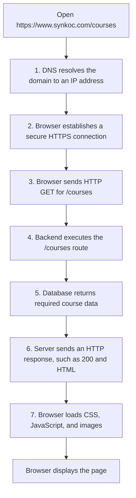

# Browser Request-Response Lifecycle

When someone opens `https://www.synkoc.com/courses`, the browser and web application communicate in stages. The exact server implementation is not visible from the URL alone; the sequence below describes a typical request for a page.

## Seven Stages

1. **DNS lookup:** The browser looks up the IP address associated with `www.synkoc.com`. DNS is like a directory that helps locate the server for a domain name.
2. **Secure HTTPS connection:** The browser establishes a connection protected by HTTPS, including negotiating encryption and checking the server's certificate.
3. **HTTP GET request:** The browser sends an HTTP `GET` request for the `/courses` path. A GET request asks to retrieve a resource.
4. **Backend route:** The backend receives the request and runs the application logic associated with `/courses`.
5. **Database query:** If course information is needed, the backend asks the database for the relevant data. The database returns matching records to the backend.
6. **HTTP response:** The server sends a response containing a status code (for example, `200 OK` when successful) and content such as HTML. A failure or redirect could produce a different status and response.
7. **Browser rendering:** The browser processes the HTML and may request referenced CSS, JavaScript, and images. It uses those resources to display the page.

## Flowchart

## Important Detail

The browser renders the response it receives. The database does not send a webpage directly to the browser: the backend uses database results as needed and prepares the HTTP response. After receiving HTML, the browser may make additional requests for linked resources.

