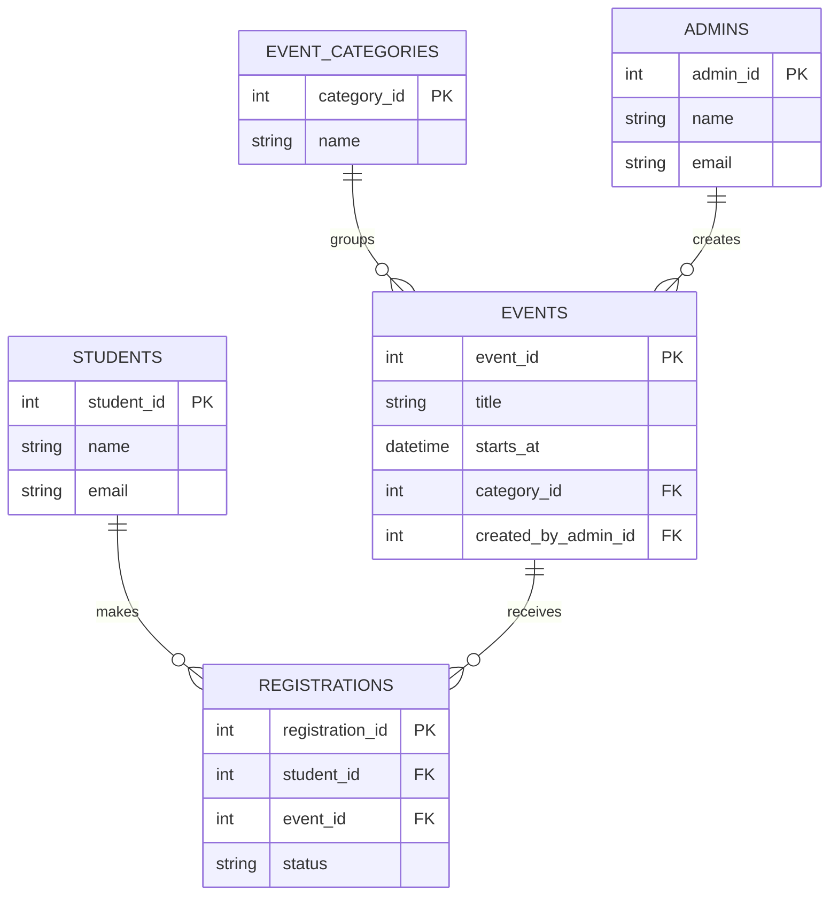

# CampusConnect – Project Planning

> **Planning document only:** This document records an initial application plan. It does not claim that CampusConnect has been built, and it does not implement the application.

## Project Introduction

**CampusConnect** is a proposed college event registration system. It is intended to give students one central place to discover college events, register for them online, and track their registrations. Administrators can create events and manage student registrations.

## Problem Statement

Students may receive college event information through different platforms, making it difficult to find current details and keep track of registrations. CampusConnect is planned as one place to publish event information and manage the registration process.

## Objectives

- Present upcoming college events and announcements in one place.
- Let students browse event details and register for selected events.
- Let students review their registered events and registration status.
- Give administrators a planned workflow for creating events and managing registrations.
- Keep student, event, category, and registration information organized.

## Target Users

| User | Planned use |
| --- | --- |
| College students | Discover events, register, and track registration status. |
| Event organizers | Provide event information and coordinate event administration. |
| Faculty members | View and support relevant college events. |
| Administrators | Create and maintain events and manage student registrations. |

## Main Features

- Browse upcoming events and announcements.
- View event details, including schedule, venue, and category.
- Submit an event registration.
- View personal registrations and their statuses.
- Create and manage events through an administrator area.
- Review and manage registrations as an administrator.

These are planned features, not completed functionality.

## Five Application Pages

| Page | Planned purpose |
| --- | --- |
| **Home Page** | Students view upcoming college events and announcements. |
| **Events Page** | Students browse available events and check event details. |
| **Registration Page** | Students enter their details and register for a selected event. |
| **My Registrations** | Students view their registered events and registration status. |
| **Admin Dashboard** | Administrators create events and manage student registrations. |

## Planned Database Entities

| Entity | Purpose | Example information to store |
| --- | --- | --- |
| **Students** | Represents student accounts that can register for events. | Student identifier, name, email, and account details. |
| **Events** | Represents college events available to students. | Event identifier, title, description, date and time, venue, category, capacity, and creator. |
| **Registrations** | Connects a student to an event and tracks that student's registration. | Registration identifier, student, event, registration date, and status. |
| **Admins** | Represents administrator accounts that manage event information and registrations. | Admin identifier, name, email, and account details. |
| **Event Categories** | Groups events by type to help organize and browse them. | Category identifier and category name. |

Account credentials, if supported, should be handled securely; passwords should not be stored as plain text. The exact fields and privacy requirements would need to be reviewed before implementation.

## Entity Relationships

- One **Student** can have many **Registrations**; each registration belongs to one student.
- One **Event** can have many **Registrations**; each registration is for one event.
- Together, Students and Events have a many-to-many relationship represented by **Registrations**.
- One **Event Category** can describe many **Events**; each event is planned to have one category.
- One **Admin** can create or manage many **Events**; an event may record the admin who created it.

The diagram shows a basic proposed data model. It is a planning view, not an implemented schema.

## Basic User Workflow

1. A student opens the Home Page and reviews upcoming events.
2. The student opens the Events Page and checks an event's details.
3. The student completes the Registration Page for the selected event.
4. The system records the registration and its initial status.
5. The student visits My Registrations to review the event and status.

## Basic Admin Workflow

1. An administrator opens the Admin Dashboard.
2. The administrator creates an event and supplies its details and category.
3. Students can browse and register for the event.
4. The administrator reviews registrations and updates them as appropriate.
5. The administrator maintains the event information and registration records.

## Future Improvements

Possible future enhancements to evaluate include:

- Search, filtering, and sorting by date, category, or venue.
- Capacity limits and waitlists.
- Email or in-app registration notifications.
- Attendance tracking and event feedback.
- Role-based access and audit history for administrative actions.
- Accessibility, mobile-friendly layouts, and deployment planning.

